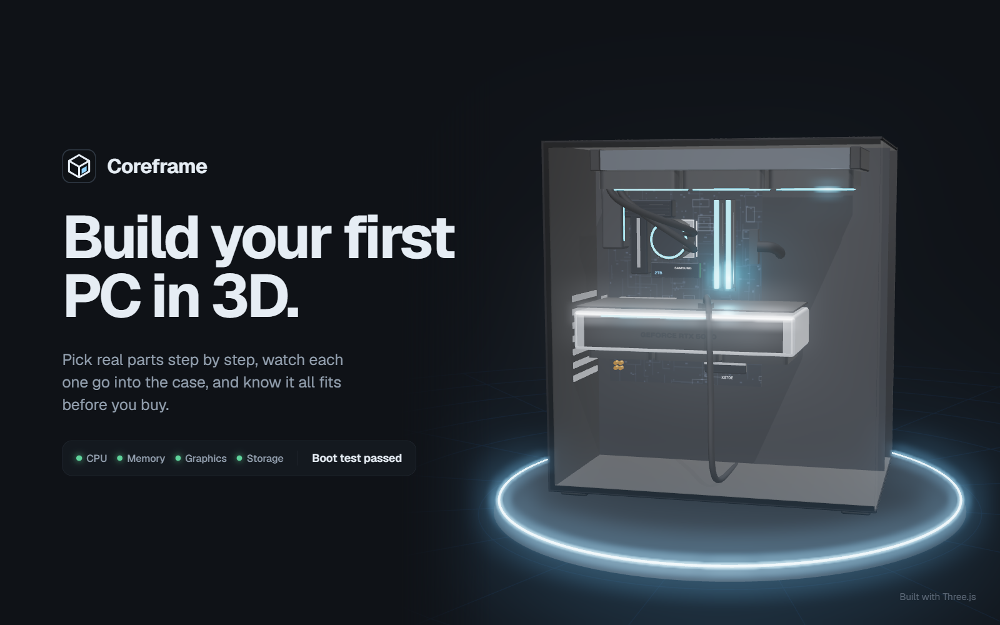

# Coreframe: plan your first PC in 3D



Pick real parts one step at a time (with official photos and plain-English explanations) and watch them go into a real-time 3D case built with Three.js. Each part is modelled to its specs: graphics card length and thickness, cooler height, radiator size, the memory slots your board has, and the real outer size of each case. Every part is checked against what's already inside, and the power button runs a boot test that lights the RGB and spins the fans, or stops at the first real problem.

## What it does

- **3D bench.** Orbit and zoom, turntable spin, **Pull apart** (every part lifts out of the case) and **See-through** (the case turns to glass with an outline). Hover a part to lift it, click it to swap it. Empty slots show as outlines so you can see where each part goes.
- **Realistic models.** Perforated mesh fronts you can see the fans through, a wood-slat front, glass-front dual-chamber cases, curved-blade fans, finned tower coolers, radiators, and sleeved power cables. Parts cast real shadows inside the case.
- **10 cases across 5 sizes:** Mini-ITX, Micro-ATX, mid tower, full tower and dual chamber, with 0 to 5 fans in the box. Most come in two colours, each with its own photo, and the 3D case recolours as you pick.
- **Sound.** A click when a part seats into place, a boot beep (or three low error beeps) on the boot test, and fans that spin up and hum while the PC runs. A busier build sounds busier. It's all generated in the browser with the Web Audio API (no audio files), and the speaker button mutes it.
- **Light and dark themes.** Dark is graphite with an ice-blue accent. It follows your system setting, and the toggle remembers your choice.
- **Drag and drop, or tap Add.** Drag a card into the case with a mouse, or press and hold on touch screens.
- **Compatibility checks.** CPU socket, memory type, board size vs. case, graphics card length, cooler height, radiator size, M.2 slots, power supply wattage, a missing cooler, missing graphics on CPUs without them, and cases that ship without fans.
- **Boot test.** Checks CPU, memory, graphics and storage in turn. A pass lights the RGB and spins every fan; a fail flashes the faulty part red and opens its step.
- **Game fps estimates** for 10 popular games at 1080p, 1440p and 4K, with a plain-language bottleneck note.
- **Build for my budget.** Tries every CPU and graphics card pairing for the fastest working build under your budget, then spends what's left on storage, cooling and a better case.
- **Starter builds, saved builds, share links.** The URL always holds the current build (case colour included), so a link is a full build.
- **₹ INR / $ USD**, with Amazon links (amazon.in or amazon.com) that search for the exact model and colour.

## Performance

- The 3D scene loads after the page is usable, and Three.js is preloaded in parallel.
- It only draws when something changes. It stops completely when the view is off screen or the tab is hidden.
- Bloom only runs while the PC is powered on. Shadows are only recalculated when parts move.
- Geometry, textures and labels are cached and shared. The fins on each tower cooler are a single instanced mesh.
- On a slow device it lowers the render resolution instead of stuttering.
- Product photos are 640px WebP (about 1.9 MB for all 55) and load lazily.

## Brand and press images

- `img/logo.svg`: the mark, an isometric case (the frame) with its glass side lit (the core). Also the favicon; `img/icon-180.png` is the home-screen icon.
- `press/coreframe-thumbnail.png` (1600×1000): the portfolio thumbnail.
- `press/coreframe-social.png` (1200×630): the link-preview image used by `og:image`. Social sites need an absolute URL, so set it to your deployed address.
- `press/thumbnail.html`: renders both with the real 3D engine. Open it at either size and take a screenshot to regenerate them.

## Run locally

It's a static site with no build step:

```bash
python .claude/serve.py 8418
```

Then open http://localhost:8418.

## Deploy to GitHub Pages

1. Push these files to the root of a repository (for example `interactive-PC-builder`).
2. In **Settings → Pages**, set the source to the `main` branch, root folder.

Netlify, Vercel and Cloudflare Pages also work: drop in the folder, no build command.

## Make it yours

- **Affiliate income:** put your Amazon Associates tags in `AFFILIATE` in `js/data.js`.
- **Prices and parts:** everything is in `js/data.js`. Change `CATALOG_UPDATED` when you refresh prices. A case entry lists its real size (`dims`), its fans (`fans`) and its colours, each with a photo.
- **Performance model:** `GAMES` in `js/data.js` holds per-game baselines, and `fps()` in `js/engine.js` holds the formula.

## Files

```
index.html        markup, dialogs, Three.js import map, theme bootstrap
css/style.css     the visual system (flat, Geist; light cobalt / dark ice themes)
img/parts/        official product photos (see img/CREDITS.md)
img/logo.svg      logo and favicon
press/            portfolio thumbnail, social card, and the page that renders them
js/scene.js       the 3D case, part models, lighting, shadows, animation
js/data.js        parts, cases and colours, games, starter builds
js/engine.js      compatibility, power, fps, auto-build, share links
js/app.js         UI, steps, drag and drop, boot test, theme
js/sound.js       sound effects (Web Audio)
```
